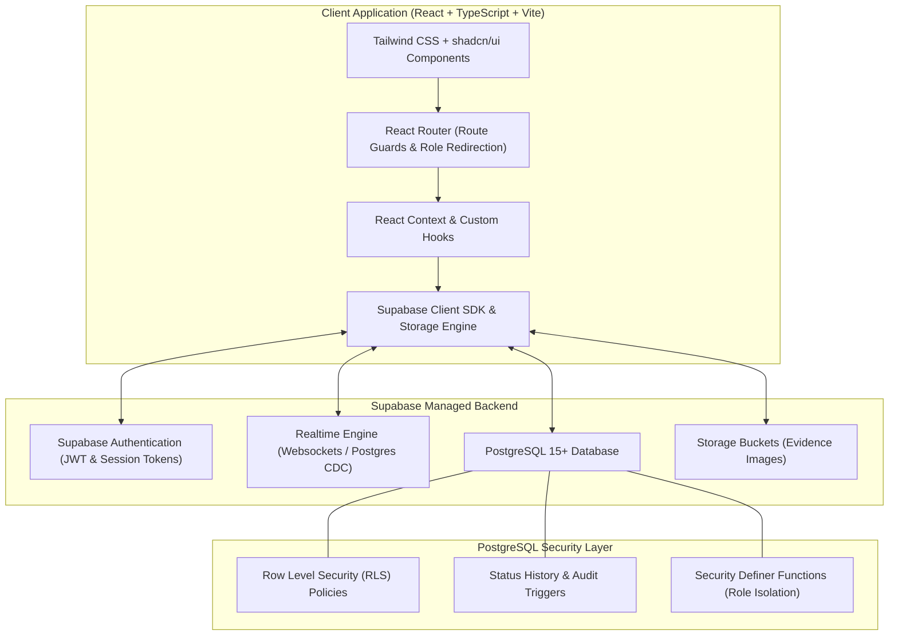
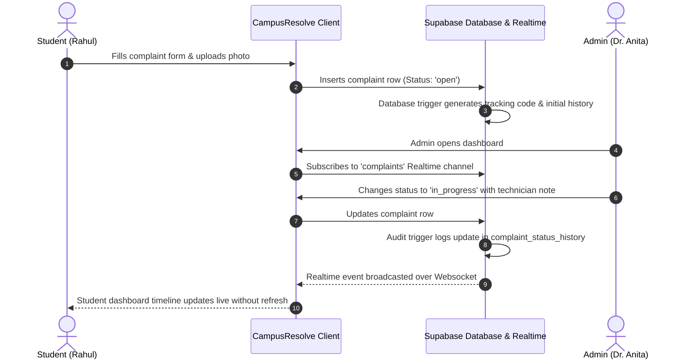

# CampusResolve — Architecture & Technical Specifications

## 1. System Overview

CampusResolve is an institutional, multi-tenant web platform designed for universities to manage, track, and resolve facility and operational complaints. The application follows a modern **Backend-as-a-Service (BaaS)** architecture pairing a high-performance React + TypeScript Single Page Application (SPA) with Supabase (PostgreSQL, Supabase Auth, Storage, and Realtime Engine).

---

## 2. Component Architecture

### A. Presentation & Routing Layer
- **Vite + React 18 + TypeScript**: Strict typechecking, ES Modules bundler, optimized vendor splitting.
- **Tailwind CSS**: Utility-first CSS with customized campus theme palette (Slate & Navy surfaces, Blue actions, Emerald for resolved, Amber for in-progress).
- **React Router v6**: Client-side routing with nested `ProtectedRoute` wrappers validating user authentication and granular role restrictions (`student` vs. `admin`).

### B. Business Logic & Service Layer
- `complaintService.ts`: Centralized service abstraction handling complaint queries, mutations, comments, and realtime channel listeners.
- `storageService.ts`: Validates file size (max 5MB), MIME types (JPEG, PNG, WebP), uploads to Supabase Storage, and resolves public URLs.
- `AuthContext.tsx`: Manages active user sessions, profile hydration from `public.profiles`, and fast one-click persona switching for examiner demonstrations.

### C. Database & Security Layer
- **PostgreSQL Database**: Relational schema maintaining referential integrity across users, complaints, comments, and status audit logs.
- **Row Level Security (RLS)**: Enforces access control at the database engine level. Even if a user attempts direct PostgREST API calls or alters browser state, they cannot read other students' private complaints or elevate their role to administrator.
- **Automated Triggers**: `trg_log_complaint_status_change` automatically captures every status change in `complaint_status_history` along with changer identity and timestamps.

---

## 3. Realtime Lifecycle & Event Flow

---

## 4. Key Architectural Decisions & Trade-offs

| Decision | Rationale | Alternatives Considered |
|---|---|---|
| **Supabase BaaS over Custom Express API** | Eliminates boilerplate REST CRUD, provides enterprise-grade PostgreSQL with declarative RLS, built-in Auth, Storage, and Realtime websocket replication. | Custom Node/Express server (would require duplicate authorization checks and separate websocket server). |
| **Database Triggers for Audit Trail** | Prevents client-side spoofing of history. Every state transition is guaranteed to be recorded atomically. | Client-side inserts to history table (vulnerable to tampering). |
| **Tailwind CSS over Component Frameworks** | Zero-runtime CSS, fully custom brand styling matching institutional design guidelines, lightweight bundle. | Material UI / Ant Design (heavy bundle size and generic appearance). |
| **Optimized Vendor Chunking** | Separates core vendor libraries (`react-vendor`, `recharts`, `supabase`) to keep all JavaScript bundles under 500kB. | Single monolithic bundle. |
