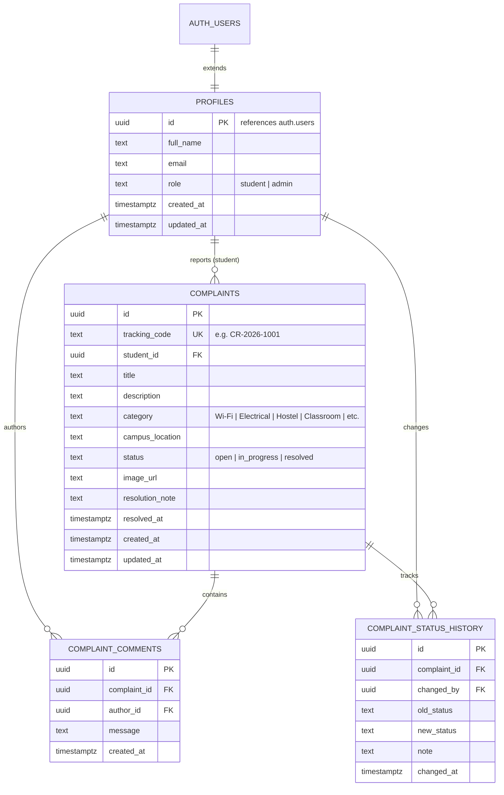

# CampusResolve — Database Schema & Security Design

## 1. Entity-Relationship Diagram (ERD)



---

## 2. Table Specifications

### `public.profiles`
Stores extended user profile information mapped 1:1 with Supabase Auth users.
- **Constraints**: `role IN ('student', 'admin')`.
- **Trigger**: `trg_protect_profile_role` prevents non-admin users from altering their role.

### `public.complaints`
Central repository for campus complaints.
- **Constraints**:
  - `status IN ('open', 'in_progress', 'resolved')`
  - `category IN ('Wi-Fi / Network', 'Electrical', 'Hostel', 'Classroom', 'Cleanliness', 'Water / Plumbing', 'Library', 'Other')`
  - `tracking_code UNIQUE`

### `public.complaint_comments`
Discussion and official communication between students and campus administrators.

### `public.complaint_status_history`
Append-only audit trail automatically populated whenever a complaint status transition occurs.

---

## 3. Row Level Security (RLS) Matrix

| Table | Operation | Target Role | Security Rule (USING / WITH CHECK) |
|---|---|---|---|
| `profiles` | SELECT | `authenticated` | `true` (Authenticated users can read display names) |
| `profiles` | UPDATE | `authenticated` | `id = auth.uid()` (Users can only update their own profile; role changes rejected by trigger) |
| `complaints` | SELECT | `authenticated` | `student_id = auth.uid() OR is_admin()` (Students view own, Admins view all) |
| `complaints` | INSERT | `authenticated` | `student_id = auth.uid()` (Students can only insert rows where they are the owner) |
| `complaints` | UPDATE | `authenticated` | `is_admin()` (Only administrators can update complaint status and resolution notes) |
| `complaint_comments` | SELECT | `authenticated` | Complaint owner `student_id = auth.uid() OR is_admin()` |
| `complaint_comments` | INSERT | `authenticated` | `author_id = auth.uid()` AND authorized to view complaint |
| `complaint_status_history` | SELECT | `authenticated` | Complaint owner `student_id = auth.uid() OR is_admin()` |
| `complaint_status_history` | INSERT | `authenticated` | Managed automatically via `trg_log_complaint_status_change` |

---

## 4. Performance Indexes

```sql
CREATE INDEX idx_complaints_student_id ON public.complaints(student_id);
CREATE INDEX idx_complaints_status ON public.complaints(status);
CREATE INDEX idx_complaints_category ON public.complaints(category);
CREATE INDEX idx_complaints_created_at ON public.complaints(created_at DESC);
CREATE INDEX idx_comments_complaint_id ON public.complaint_comments(complaint_id);
CREATE INDEX idx_history_complaint_id ON public.complaint_status_history(complaint_id);
```
