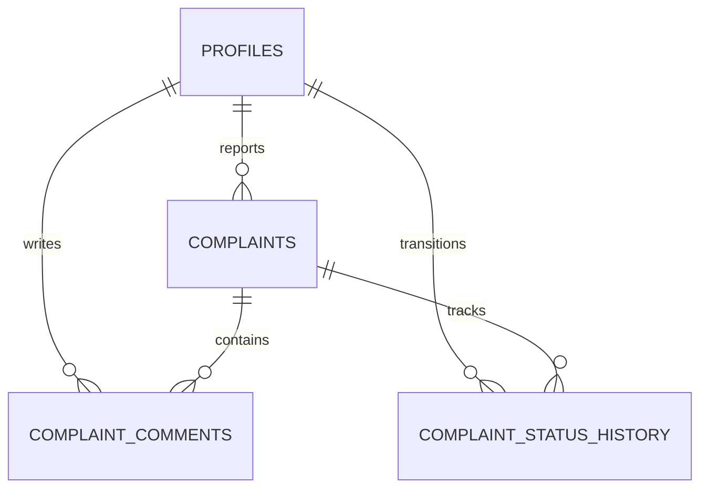
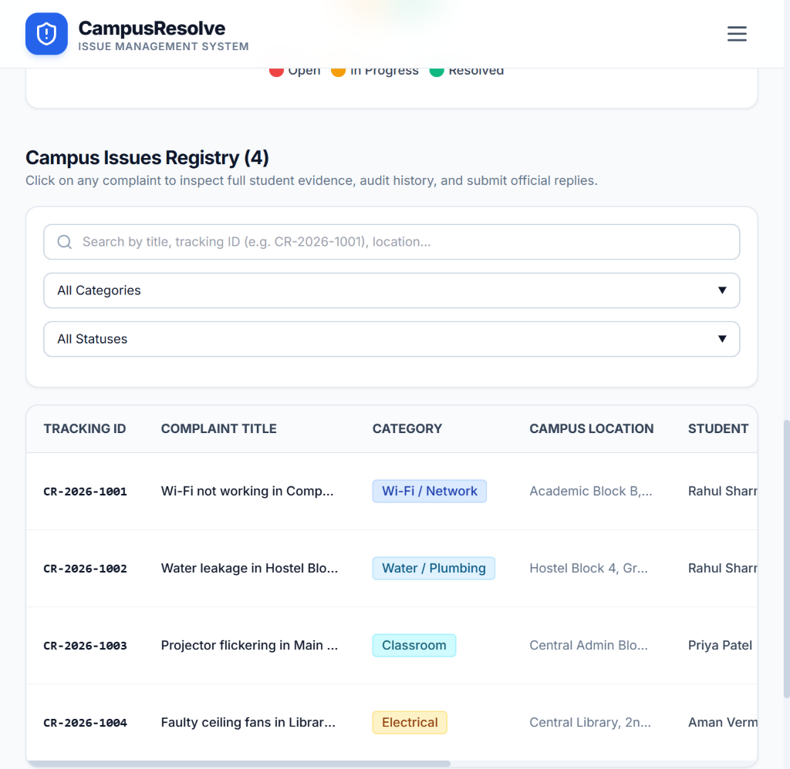

# PROJECT REPORT DRAFT
## CampusResolve: A Real-Time Smart Campus Complaint and Issue Management System

---

### 1. Project Title
**CampusResolve — A Real-Time Smart Campus Complaint and Issue Management System**

---

### 2. Abstract
In higher education institutions, maintaining campus facilities—including network infrastructure, laboratory apparatus, classroom audiovisual systems, water supply, and electrical utilities—is fundamental to delivering an uninterrupted learning environment. Currently, student complaints are predominantly reported through informal, ad-hoc mechanisms such as verbal reports, physical paper ledgers, or unmonitored messaging groups. These legacy practices cause significant delays, lost complaints, lack of accountability, and zero visibility for students regarding resolution progress. 

To address this challenge, **CampusResolve** was developed as an institutional, full-stack, real-time web application. Built using React, TypeScript, Tailwind CSS, and Supabase (PostgreSQL), CampusResolve provides a unified platform where students can file categorized complaints with photographic evidence, receive unique tracking codes (`CR-YYYY-XXXX`), and observe live progress updates. Campus administrators utilize an administrative dashboard equipped with category analytics, ticket dispatching tools, and audit history logs. Enforcing PostgreSQL Row Level Security (RLS) and database triggers ensures data isolation and transparency across the campus community.

---

### 3. Introduction
Modern university campuses accommodate thousands of students and faculty members across diverse facilities: academic blocks, research laboratories, hostels, libraries, dining halls, and sports complexes. As physical infrastructure expands, equipment failures and maintenance requirements naturally occur. 

CampusResolve transforms maintenance management by establishing a structured digital pipeline connecting the student body directly with facility administrators and technicians, replacing opacity with real-time institutional accountability.

---

### 4. Problem Statement
Traditional complaint handling in universities exhibits critical deficiencies:
1. **Lack of Centralization**: Complaints are scattered across departmental offices, hostel wardens, and IT helpdesks with no single source of truth.
2. **Missing Photographic Evidence**: Verbal descriptions frequently lack technical clarity, requiring technicians to make redundant exploratory visits.
3. **No Resolution Tracking**: Once reported, students have no mechanism to determine whether a ticket has been acknowledged, assigned, or resolved.
4. **Absence of Administrative Analytics**: Facility heads cannot systematically identify recurring problem hotspots or measure turnaround times.

---

### 5. Limitations of Existing Systems
| Feature | Physical Ledger / WhatsApp | Legacy Campus Portals | CampusResolve |
|---|---|---|---|
| **Tracking Identifier** | None | Generic Numeric ID | Formatted `CR-YYYY-XXXX` |
| **Photographic Evidence** | Not possible / Cluttered chat | Often unsupported | Integrated Cloud Storage |
| **Real-Time Updates** | None | Requires manual reload | Supabase Websockets |
| **Audit Trail** | Vulnerable to alteration | Basic timestamp | PostgreSQL Database Triggers |
| **Role Isolation** | Unenforced | Basic session check | Engine-level RLS Policies |

---

### 6. Proposed Solution
CampusResolve introduces a comprehensive digital ecosystem:
- **Role-Based Portals**: Tailored interfaces for Students (filing and personal tracking) and Administrators (analytics, filtering, dispatch, and resolution).
- **Immutable Status Audit Trail**: Automated logging of every status transition (`Open` &rarr; `In Progress` &rarr; `Resolved`) with changer credentials and notes.
- **Real-Time Websocket Synchronization**: Automatic UI updates on active client sessions via Supabase Realtime when ticket statuses are modified.
- **Photographic Attachment**: Direct image upload enabling students to submit visual proof of physical defects.

---

### 7. Objectives
1. Design an accessible, responsive web interface adhering to institutional usability standards.
2. Implement secure authentication with distinct student and administrator roles.
3. Enforce strict database authorization using PostgreSQL Row Level Security (RLS).
4. Automate ticket generation and audit history logging via database triggers.
5. Provide visual analytics displaying campus issue distribution by facility and category.

---

### 8. Technology Stack
- **Frontend Framework**: React 18 with TypeScript and Vite
- **Styling & UI**: Tailwind CSS, Lucide React Icons
- **Data Visualization**: Recharts (Pie and Bar Analytics)
- **Form Management**: Controlled inputs with client-side validation
- **Backend & Database**: Supabase (PostgreSQL 15+)
- **Authentication**: Supabase Auth (JWT & Session Tokens)
- **Object Storage**: Supabase Storage (`complaint-evidence` bucket)
- **Realtime Engine**: PostgreSQL Change Data Capture (CDC) via WebSockets
- **Testing Framework**: Vitest with `@testing-library/react` and JSDOM

---

### 9. System Architecture
CampusResolve implements a decoupled, modern Single-Page Application (SPA) architecture communicating with a managed PostgreSQL backend via Supabase client libraries:

---

### 10. Frontend Implementation
The frontend is constructed using modular, reusable React components:
- **Navigation & Guarding**: `Navbar`, `Footer`, and `ProtectedRoute` components enforcing role separation and mobile drawer menus.
- **Complaint Workflows**: `ComplaintCard`, `StatusTimeline`, and `CommentThread` providing intuitive user interaction.
- **Dashboard & Analytics**: `StatCard` and `AnalyticsCharts` powered by Recharts for data visualization.
- **Forms & Dialogs**: `Input`, `Select`, `Textarea`, and `Modal` components with client-side validation.

---

### 11. Backend Implementation
The application operates on a Backend-as-a-Service (BaaS) architecture powered by Supabase:
- **Authentication**: Native JWT issuance and session management.
- **API Engine**: PostgREST exposing PostgreSQL tables and views with automatic query parameterization.
- **Realtime**: Logical decoding of PostgreSQL WAL changes broadcasted over WebSocket channels.
- **Storage**: S3-compatible bucket (`complaint-evidence`) with strict MIME validation.

---

### 12. Database Schema
The database comprises four normalized tables: `profiles`, `complaints`, `complaint_comments`, and `complaint_status_history`.

---

### 13. Authentication and Security
- **Row Level Security (RLS)**: Enforces table-level access rules directly in the database engine (`student_id = auth.uid() OR is_admin()`).
- **Role Self-Elevation Guard**: The `protect_profile_role` database trigger prevents non-admin users from altering their role.
- **Safe Environment Handling**: Client credentials use `.env` placeholders without committing secrets to version control.

---

### 14. Major Features
1. **Automated Tracking Code Generation**: Standard format `CR-YYYY-XXXX`.
2. **Three-Stage Progress Timeline**: Open &rarr; In Progress &rarr; Resolved.
3. **Photographic Evidence Upload**: Image attachment with preview and full-screen inspection modal.
4. **Follow-Up Discussion Thread**: Bidirectional communication between students and administrators.
5. **Interactive Analytics**: Real-time category and status charts.

---

### 15. Implementation Methodology
The project followed an agile, phased delivery methodology:
- Phase 1: Workspace audit and repository setup.
- Phase 2: Application foundation and dependency setup.
- Phase 3: Complete student and administrator UI flows.
- Phase 4: Supabase database schema, triggers, and RLS policies.
- Phase 5: Automated test suite creation (Vitest) and browser visual verification.
- Phase 6: Documentation and viva preparation.

---

### 16. Testing Methodology
Testing was conducted across multiple levels:
- **Static Analysis**: TypeScript compiler (`tsc -b`) and ESLint.
- **Unit & Service Testing**: Vitest test suites verifying complaint creation, tracking codes, status history, and comments.
- **End-to-End Simulation**: 20-step lifecycle test covering the complete student-to-admin workflow.
- **Browser Visual Audit**: Headless browser verification with screenshot captures.

---

### 17. Actual Test Results
- **Vitest**: 6/6 tests passing ([TESTING.md](file:///d:/FSD%20PROJECT/docs/TESTING.md)).
- **TypeScript**: 0 compiler errors.
- **Production Build**: Built in 5.63s with optimized vendor chunks (`react-vendor`, `recharts`, `supabase`).

---

### 18. Application Screenshots
Below is the verified screenshot captured from the active CampusResolve application during browser quality audit:

*Figure 18.1: CampusResolve Administrator Portal displaying metric stat cards, Recharts category analytics bar chart, status breakdown donut chart, and the live complaints registry table.*

---

### 19. Limitations
1. Single-campus deployment without multi-campus branching.
2. Automated SMS alerts require external gateway integration.
3. Offline queueing requires service worker caching enhancements.

---

### 20. Future Enhancements
1. **QR-Code Integration**: Affixing QR codes to classroom desks to pre-fill room and building coordinates.
2. **Push Notifications**: Mobile push notifications for instant status changes.
3. **Machine Learning Categorization**: Automatic classification of complaint text into appropriate departmental queues.

---

### 21. Conclusion
CampusResolve provides an end-to-end, demonstrable university complaint management system that satisfies all academic review criteria: frontend design, backend architecture, security implementation, and project documentation.

---

### 22. References
1. React Documentation: https://react.dev/
2. Supabase Documentation & Guides: https://supabase.com/docs/
3. PostgreSQL Row Level Security: https://www.postgresql.org/docs/current/ddl-rowsecurity.html
4. Tailwind CSS Framework: https://tailwindcss.com/
5. Recharts Documentation: https://recharts.org/
