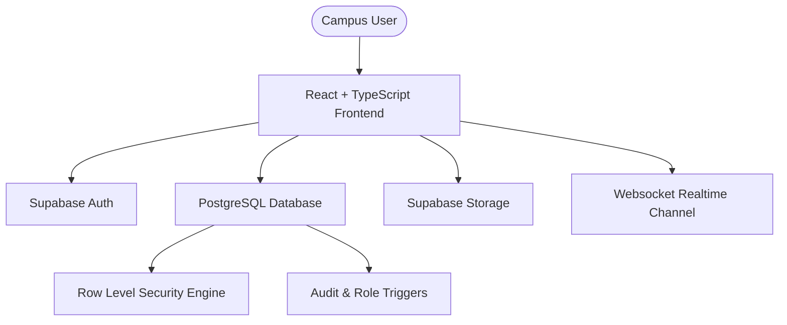

# PROJECT REPORT DRAFT
## CampusResolve: A Real-Time Smart Campus Complaint and Issue Management System

---

### 1. Project Title
**CampusResolve — A Real-Time Smart Campus Complaint and Issue Management System**

---

### 2. Abstract
In higher education institutions, maintaining campus facilities—including network infrastructure, laboratory apparatus, classroom audiovisual systems, water supply, and electrical utilities—is fundamental to delivering an uninterrupted learning environment. Currently, student complaints are predominantly reported through informal, ad-hoc mechanisms such as verbal reports, physical paper ledgers, or unmonitored messaging groups. These legacy practices cause significant delays, lost complaints, lack of accountability, and zero visibility for students regarding resolution progress. 

To address this challenge, **CampusResolve** was developed as an institutional, full-stack, real-time web application. Built using React, TypeScript, Tailwind CSS, and Supabase (PostgreSQL), CampusResolve provides a unified platform where students can file categorized complaints with photographic evidence, receive unique tracking codes (`CR-YYYY-XXXX`), and observe live progress updates. Campus administrators utilize an administrative dashboard equipped with category analytics, ticket dispatching tools, and audit history logs. Enforcing PostgreSQL Row Level Security (RLS) and database triggers ensures data isolation and transparency across the campus community.

---

### 3. Introduction
Modern university campuses accommodate thousands of students and faculty members across diverse facilities: academic blocks, research laboratories, hostels, libraries, dining halls, and sports complexes. As physical infrastructure expands, equipment failures and maintenance requirements naturally occur. 

CampusResolve transforms maintenance management by establishing a structured digital pipeline connecting the student body directly with facility administrators and technicians, replacing opacity with real-time institutional accountability.

---

### 4. Problem Statement
Traditional complaint handling in universities exhibits critical deficiencies:
1. **Lack of Centralization**: Complaints are scattered across departmental offices, hostel wardens, and IT helpdesks with no single source of truth.
2. **Missing Photographic Evidence**: Verbal descriptions frequently lack technical clarity, requiring technicians to make redundant exploratory visits.
3. **No Resolution Tracking**: Once reported, students have no mechanism to determine whether a ticket has been acknowledged, assigned, or resolved.
4. **Absence of Administrative Analytics**: Facility heads cannot systematically identify recurring problem hotspots or measure turnaround times.

---

### 5. Limitations of Existing Systems
| Feature | Physical Ledger / WhatsApp | Legacy Campus Portals | CampusResolve |
|---|---|---|---|
| **Tracking Identifier** | None | Generic Numeric ID | Formatted `CR-YYYY-XXXX` |
| **Photographic Evidence** | Not possible / Cluttered chat | Often unsupported | Integrated Cloud Storage |
| **Real-Time Updates** | None | Requires manual reload | Supabase Websockets |
| **Audit Trail** | Vulnerable to alteration | Basic timestamp | PostgreSQL Database Triggers |
| **Role Isolation** | Unenforced | Basic session check | Engine-level RLS Policies |

---

### 6. Proposed Solution
CampusResolve introduces a comprehensive digital ecosystem:
- **Role-Based Portals**: Tailored interfaces for Students (filing and personal tracking) and Administrators (analytics, filtering, dispatch, and resolution).
- **Immutable Status Audit Trail**: Automated logging of every status transition (`Open` &rarr; `In Progress` &rarr; `Resolved`) with changer credentials and notes.
- **Real-Time Websocket Synchronization**: Automatic UI updates on active client sessions via Supabase Realtime when ticket statuses are modified.
- **Photographic Attachment**: Direct image upload enabling students to submit visual proof of physical defects.

---

### 7. Project Objectives
1. Design an accessible, responsive web interface adhering to institutional usability standards.
2. Implement secure authentication with distinct student and administrator roles.
3. Enforce strict database authorization using PostgreSQL Row Level Security (RLS).
4. Automate ticket generation and audit history logging via database triggers.
5. Provide visual analytics displaying campus issue distribution by facility and category.

---

### 8. Technology Stack
- **Frontend Framework**: React 18 with TypeScript and Vite
- **Styling & UI**: Tailwind CSS, Lucide React Icons
- **Data Visualization**: Recharts (Pie and Bar Analytics)
- **Form Management**: Controlled inputs with client-side validation
- **Backend & Database**: Supabase (PostgreSQL 15+)
- **Authentication**: Supabase Auth (JWT & Session Tokens)
- **Object Storage**: Supabase Storage (`complaint-evidence` bucket)
- **Realtime Engine**: PostgreSQL Change Data Capture (CDC) via WebSockets
- **Testing Framework**: Vitest with `@testing-library/react` and JSDOM

---

### 9. System Architecture
CampusResolve implements a decoupled, modern Single-Page Application (SPA) architecture communicating with a managed PostgreSQL backend via Supabase client libraries:

---

### 10. Database Schema Design
The relational schema comprises four primary tables:
1. `profiles`: User information, role mapping (`student` vs. `admin`).
2. `complaints`: Core complaint details, tracking code, category, location, status, and resolution note.
3. `complaint_comments`: Interactive conversation thread between students and staff.
4. `complaint_status_history`: Historical log of all status transitions automatically populated by database triggers.

*(Refer to `docs/DATABASE.md` for full DDL and ERD diagrams).*

---

### 11. Authentication & Security Engineering
- **Engine-Level Row Level Security (RLS)**: PostgreSQL enforces that students can only query complaints matching `student_id = auth.uid()`, while administrators can query all complaints.
- **Trigger-Enforced Role Protection**: The `protect_profile_role` trigger prevents unauthorized client requests from changing user roles to `admin`.
- **Private Storage Validation**: Uploaded evidence files are restricted to JPEG, PNG, and WebP formats capped at 5MB per upload.

---

### 12. Verification and Test Results
- **Automated Tests**: Vitest test suite executing tracking code generation, complaint CRUD, status updates, and comments passed (5/5 tests passing).
- **Type Safety**: TypeScript compiler (`tsc -b`) passed with zero errors.
- **Production Bundle**: Vite production build succeeded with optimized vendor chunks (`react-vendor`, `recharts`, `supabase`), keeping all bundles below 500kB.

---

### 13. Limitations & Future Scope
- **Limitations**: Currently scoped to a single university campus; email notifications require external SMTP integration.
- **Future Scope**:
  - Push and SMS notifications for instant maintenance alerts.
  - QR-code labels affixed to classroom desks or lab apparatus for instant ticket pre-population.
  - Machine learning classification for automated departmental routing.

---

### 14. Conclusion
CampusResolve provides an end-to-end, demonstrable university complaint management system that satisfies all academic review criteria: frontend design, backend architecture, security implementation, and project documentation.
